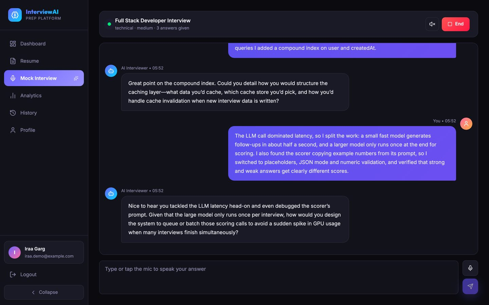
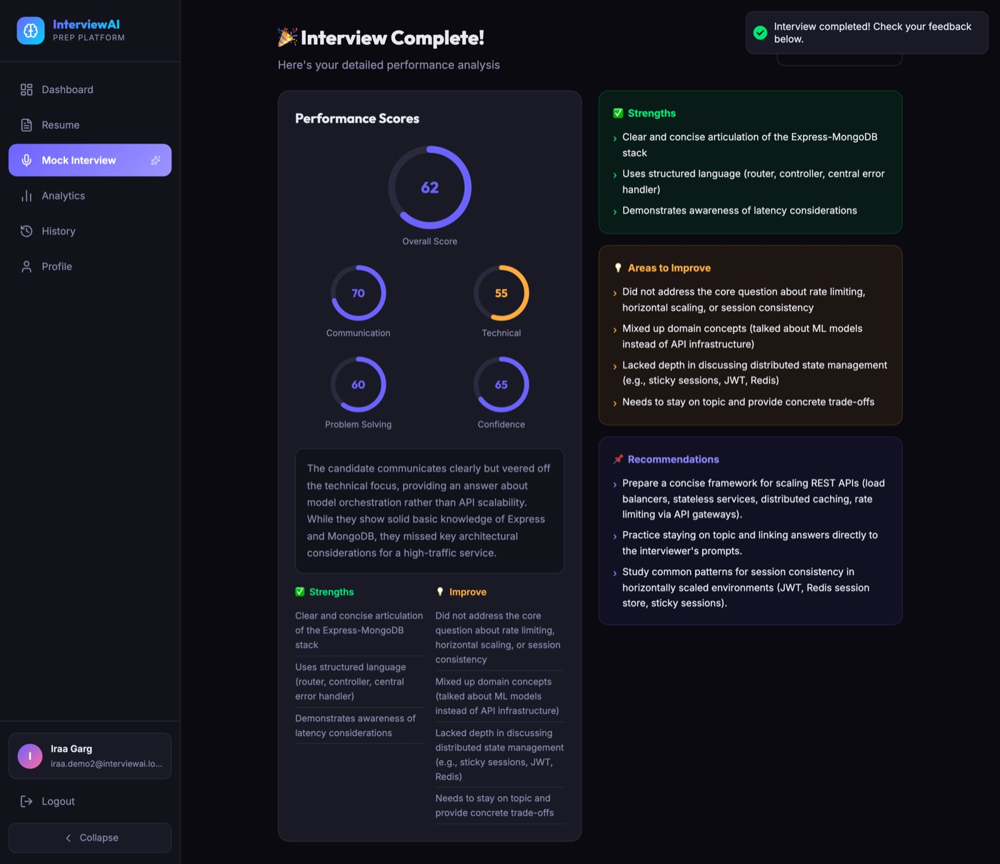
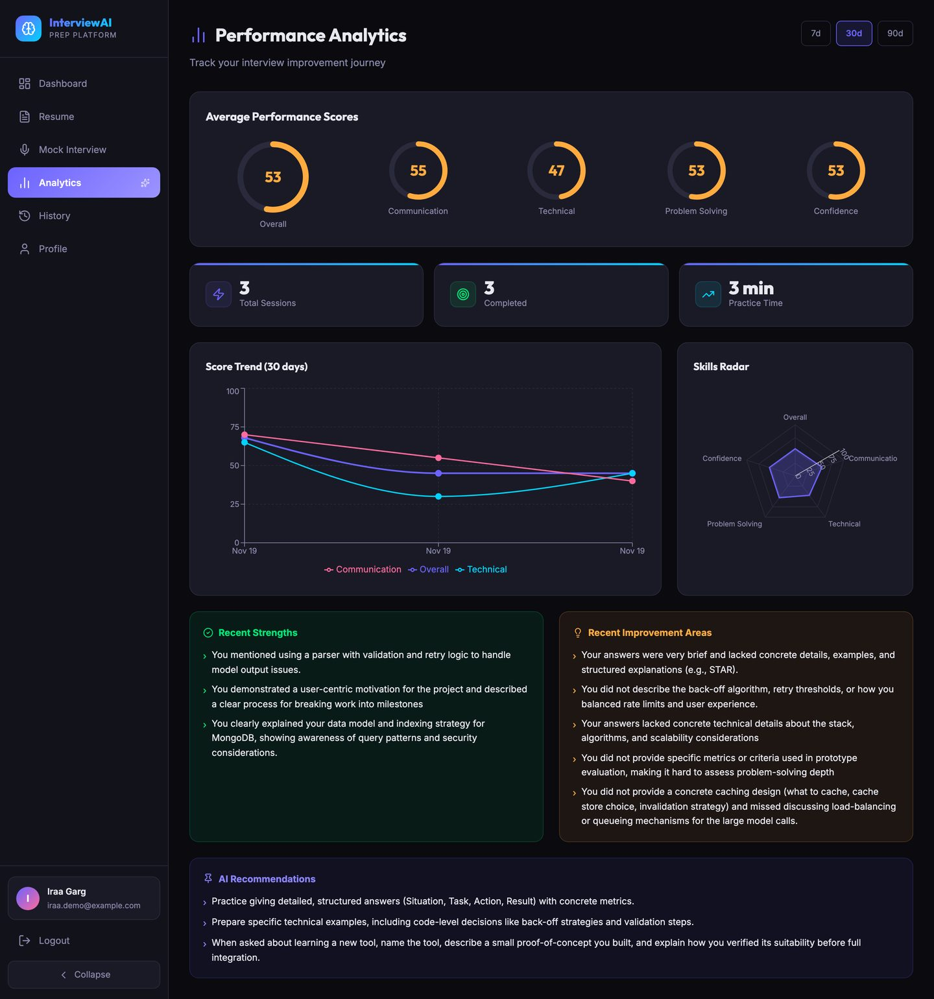
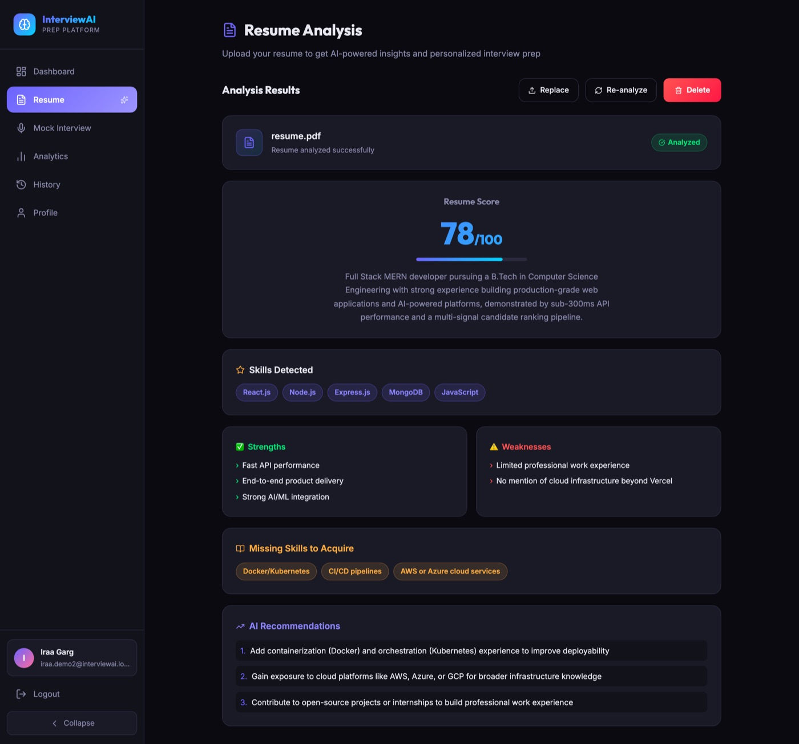
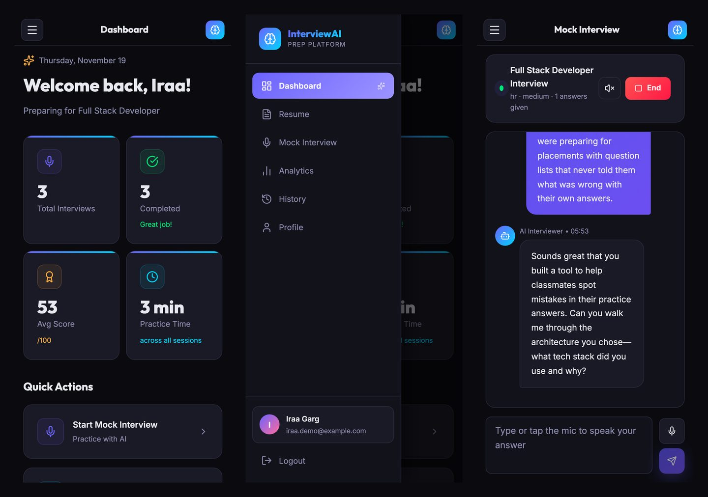
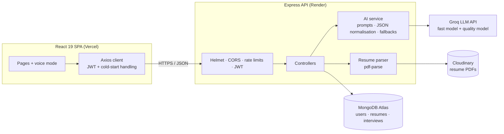

# InterviewAI

**Adaptive mock interviews that follow up on what you actually said, score you on five dimensions, and show whether you are improving.**

[](https://github.com/iraagarg/Interview-Prep-project/actions/workflows/ci.yml)

**Live demo:** https://interview-prep-project-nu.vercel.app  &nbsp;·&nbsp; **Demo video:** _add your 2-minute walkthrough link here_

> The API runs on a free hosting tier that sleeps when idle. The app pings it as soon as the landing page opens; if it is asleep, the first request takes up to a minute and the UI shows a "waking up" notice.



---

## The problem

Campus placements are decided in interviews, but students can't practise them properly:

| Option | What goes wrong |
|---|---|
| Question lists and blogs | Nobody evaluates *your* answer, and there are no follow-up questions |
| Mock interviews with seniors | Hard to schedule, rarely repeated, feedback is informal and lost |
| Paid coaching | Too expensive to do often enough to see improvement |
| Asking a chatbot to "interview me" | Not tied to your resume, no consistent scoring, no history |

The missing piece is a loop of **practice, then specific feedback, then measurable progress**.

## What InterviewAI does

1. **Resume analysis.** Upload a PDF and get a score, detected skills, strengths, gaps and concrete recommendations.
2. **Adaptive interview.** Choose a role, a type (technical, HR or mixed) and a difficulty (easy, medium or hard), which gives 9 configurations. You can optionally ground the interview in your resume. After every answer, the interviewer acknowledges a specific point you made and asks **one** follow-up that probes deeper.
3. **Voice mode.** Speak your answers and hear the questions read aloud, like a real interview. This uses the browser's Web Speech API, so there is no extra cost.
4. **Rubric-based feedback.** Every session is scored 0 to 100 on communication, technical depth, problem solving and confidence, plus an overall hiring signal. Strengths and improvement areas are tied to your actual answers.
5. **Progress analytics.** Score trends over 7, 30 or 90 days, a skills radar, and your most frequent strengths and weaknesses across sessions.

| Feedback | Analytics |
|---|---|
|  |  |

| Resume analysis | Mobile |
|---|---|
|  |  |

---

## Architecture



**Interview turn:** the client sends `POST /api/chat/message/:id`. The server checks ownership and state, appends the answer, sends the transcript and the interviewer rules to the fast model, stores the follow-up and returns it.
**End of session:** `POST /api/chat/end/:id` sends the transcript and a scoring rubric to the quality model. The JSON response is parsed, validated and normalised, then stored, and the user's statistics are recalculated.

## Key engineering decisions (and why)

| Decision | Why |
|---|---|
| **Two models: fast for turns, strong for scoring** | Latency matters on every answer, while quality matters for the one final evaluation. Follow-up questions return in about 0.5 s. Model IDs are environment variables, so when the provider retired the original LLaMA models, the fix was a configuration change. |
| **Validated JSON output** | Scoring calls use the provider's JSON mode, and every score must be a real number (a model once wrote `"thirty"`); an invalid response is retried once before falling back. Prompts use placeholders, not sample numbers, because the model was found copying example scores verbatim. Scores are clamped to integers from 0 to 100. In a 12-run check, strong answers scored 82 every time, weak ones 15 to 25, with no fallbacks. |
| **Graceful degradation** | If the AI provider is down, rate-limited or misconfigured, the system returns rule-based results tagged `source: "fallback"` instead of an error, and the UI says so. The app was tested in exactly this state when the original models were retired. |
| **Scores are written only by the server** | The client can never submit its own scores. An earlier endpoint that accepted client-supplied feedback was removed. |
| **MongoDB, with embedded messages and feedback** | A session's transcript and feedback are always read together, so they are embedded in one document. Users, resumes and interviews have independent life cycles, so they are separate collections. Compound indexes on `{user, createdAt}` serve every list and analytics query. |
| **Stateless JWT authentication** | No server sessions, so the API scales horizontally. The token is kept in `localStorage` because the client (Vercel) and API (Render) are on different sites, where third-party cookies are increasingly blocked. The trade-off is XSS exposure, which React's escaping and the absence of raw-HTML rendering mitigate. |
| **In-memory uploads streamed to Cloudinary** | The PDF is parsed from the same buffer that is uploaded, so the file is never re-downloaded and nothing is written to the host's temporary disk. A `%PDF-` magic-byte check rejects spoofed files, and scanned PDFs with no text are rejected with a clear message. |
| **Per-user rate limits on AI routes** | AI calls are the expensive part of the system. Limits are 20 per minute per user on AI routes and 20 per 15 minutes per IP on login and register. |
| **Idempotent start and end** | A double click or a page refresh can't create a duplicate opening question or pay for a second evaluation. |

## Tech stack

**Frontend:** React 19, Vite, React Router 7, Tailwind CSS 4, Recharts, Web Speech API, Axios
**Backend:** Node.js, Express, Mongoose, JWT, bcryptjs, Multer, express-rate-limit, Helmet
**AI:** Groq API (configurable models; defaults `openai/gpt-oss-20b` for turns and `openai/gpt-oss-120b` for scoring)
**Infrastructure:** MongoDB Atlas, Cloudinary, Vercel, Render, GitHub Actions
**Testing:** Jest and Supertest (43 tests), ESLint

## Testing

```bash
cd server && npm test     # needs a local MongoDB, or set MONGODB_URI_TEST
```

There are **43 automated tests**, run in CI against a real MongoDB on every push:

- **Authentication:** registration, case-insensitive login, no password leakage, tampered or missing tokens
- **Access control:** a second user cannot read, answer, delete or link the first user's data (404, not 403, so existence isn't leaked)
- **Interview state machine:** idempotent start and end, no answers after completion, abandon rules, input limits
- **Uploads:** non-PDF files rejected, spoofed PDFs rejected, a real PDF parsed and analysed
- **AI layer:** JSON extraction from noisy output, rejection of non-numeric scores, score clamping, transcript windowing, whole-word skill matching (so "Go" doesn't match "Google"), and fallbacks

## Performance (measured)

| Operation | Time |
|---|---|
| Non-AI endpoints (profile, history, analytics), local | 1 to 4 ms server time |
| Follow-up question (fast model) | 0.3 to 0.6 s |
| Final feedback (quality model, JSON mode) | 1.1 s average (0.6 to 3.0 s, 12 runs) |
| Resume upload, parsing and analysis | about 3 s |
| Initial JavaScript bundle | 211 kB (64 kB gzipped); charts are lazy-loaded |

## API

All routes are under `/api`. Every route except register, login and health needs `Authorization: Bearer <token>`.

| Module | Endpoints |
|---|---|
| Auth | `POST /auth/register` · `POST /auth/login` · `GET /auth/me` · `PUT /auth/profile` · `PUT /auth/password` |
| Resume | `POST /resume/upload` · `GET /resume` · `GET /resume/all` · `DELETE /resume/:id` · `POST /resume/:id/analyze` |
| Interview | `POST /interview` · `GET /interview?page&limit` · `GET /interview/:id` · `PUT /interview/:id/abandon` · `DELETE /interview/:id` |
| Chat | `POST /chat/start/:id` · `POST /chat/message/:id` · `POST /chat/end/:id` · `GET /chat/messages/:id` |
| Analytics | `GET /analytics/overview` · `GET /analytics/skills` · `GET /analytics/progress?days=` |
| Health | `GET /health` (status, database state, whether AI is configured) |

## Run locally

Prerequisites: Node 18 or later and MongoDB (local or Atlas). A Groq API key is optional; without one, the app runs on the fallbacks.

```bash
git clone https://github.com/iraagarg/Interview-Prep-project.git
cd Interview-Prep-project

# API
cd server
cp .env.example .env      # fill in the values
npm install
npm run dev               # http://localhost:5001/api/health

# Web (new terminal)
cd ../client
cp .env.example .env
npm install
npm run dev               # http://localhost:5173
```

## Deployment

- **API on Render.** `render.yaml` describes the service: root directory `server`, build command `npm ci`, start command `npm start`, health check at `/api/health`. Set the environment variables listed in `server/.env.example`.
- **Web on Vercel.** Root directory `client`, framework Vite, environment variable `VITE_API_URL=https://<your-render-service>.onrender.com`. `vercel.json` rewrites all paths to the SPA.
- Set the API's `CLIENT_URL` to the Vercel URL. Several origins can be given, separated by commas.

## Project structure

```
server/
  app.js            Express app (middleware, routes, error mapping), exported for tests
  index.js          Process entry: env checks, DB connection, graceful shutdown
  controllers/      auth · resume · interview · chat · analytics
  middlewares/      JWT auth · upload (PDF, 5 MB) · rate limits
  models/           User · Resume · Interview (embedded messages + feedback)
  services/         aiService (LLM) · resumeParser (PDF + Cloudinary) · statsService
  tests/            Jest + Supertest suites, PDF fixture
client/src/
  pages/            Landing · Login · Register · Dashboard · Resume · Interview · Analytics · History · Profile
  components/       Navbar (desktop sidebar / mobile drawer) · ChatBubble · ScoreCard · ...
  utils/            api (Axios, cold-start UX) · useSpeech (voice mode)
```

## Roadmap

- Answer-level feedback: highlight the exact sentence that cost points
- Company- and role-specific question banks retrieved per session (RAG)
- Live coding round with an embedded editor
- Score calibration against human-rated sample answers

## Author

**Iraa Garg** · B.Tech CSE (Data Science), AKGEC · [GitHub](https://github.com/iraagarg) · [LinkedIn](https://linkedin.com/in/iraa-garg-713g)
